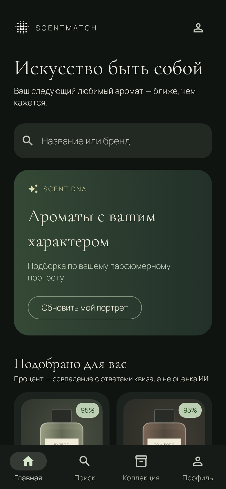

# 💜 ScentMatch

[](https://flutter.dev)
[](https://firebase.google.com)
[](https://riverpod.dev)

> 🌸 Персональный парфюмерный ассистент: квиз, подборки, поиск, коллекция и отзывы. Тёмная тема и RU/EN по умолчанию, локальный деморежим без Firebase.

**[🚀 Демо](https://gangstakz.github.io/scentmatch/)** · [Репозиторий](https://github.com/GangstaKZ/scentmatch) · [Проверки CI](./VALIDATION.md)



---

## 🧩 Возможности / Features

| Возможность | Состояние |
| --- | --- |
| Квиз из 7 шагов → до 6 персональных рекомендаций | ✅ Работает в демо |
| Поиск, фильтры (семья, бюджет, пол), карточка аромата | ✅ Работает в демо |
| Коллекция / Wishlist, оценки 0–5, заметки | ✅ Работает в демо |
| RU/EN, светлая/тёмная тема | ✅ Работает в демо |
| Отзывы (один на пользователя) | 🔹 Локально в демо; общие через Firestore |
| Вход email/Google (Firebase Auth) | 🔹 Код готов; включается подключением Firebase |
| Рекомендации на сервере / OpenAI | 🔹 Callable-функция; по умолчанию локальные правила |
| Pro (RevenueCat), сканер флакона | ⚙️ Заглушки-адаптеры |

---

## 🚀 Быстрый запуск / Quick start

```bash
flutter pub get
flutter run -d chrome      # веб в Chrome
# или: flutter run         # Android/iOS устройство
```

Без дополнительных параметров приложение стартует в **локальном деморежиме** — Firebase и API-ключи не нужны, данные хранятся на устройстве. Нужен Flutter **3.47.7** (см. `flutter --version`).

---

## 🏗 Архитектура / Architecture

```
lib/
├── core/            # config, router, theme, локализация, providers
├── features/
│   ├── auth/              # Firebase Auth + local-режим
│   ├── catalog/           # каталог ароматов
│   ├── collection/        # полки, оценки, заметки
│   ├── home/  onboarding/ # главная, онбординг
│   ├── profile/  reviews/ # профиль, отзывы
│   ├── recommendations/   # квиз-алгоритм + Cloud Function
│   └── subscription/      # RevenueCat adapter + Pro preview
└── shared/widgets/        # переиспользуемые виджеты
```

Feature-first: доменные модели не зависят от Flutter/Firebase, репозитории выбираются Riverpod'ом через composition root.

---

## ☁️ Firebase

Подробное подключение реального проекта, seed каталога, эмуляторы (`EMULATOR_HOST`), `REVERSED_CLIENT_ID` и настройка OpenAI-функций — в **[docs/FIREBASE.md](./docs/FIREBASE.md)**.

---

<div align="center">

 Made with 💜 · [Демо на GitHub Pages](https://gangstakz.github.io/scentmatch/)

</div>
